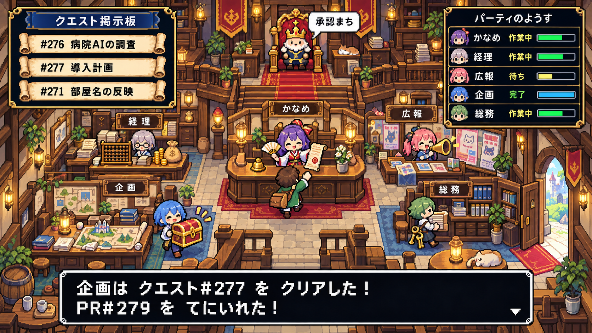

# conect-guild

AI だけで動く小さな会社を、レトロ RPG のギルド画面として眺めるアプリ。

[conect-management](https://github.com/yukihiroyamaguchi569/conect-management) では、司令塔の AI（かなめ）が社長の依頼を GitHub Issue に分解し、部門ごとの Claude Code セッション（経理・広報・企画・総務）に渡して、PR で成果を受け取ります。conect-guild はその様子を、クエスト掲示板・パーティ・玉座の王様として描きます。

| 会社 | ゲーム |
|---|---|
| GitHub Issue（部門ラベル付き） | クエストの巻物 |
| 部門セッション | パーティのメンバー |
| 司令塔（かなめ） | ギルドの受付 |
| 社長（ゆきひろ） | 玉座の王。承認待ちは「承認まち」の吹き出し |
| PR | 宝箱。マージで「最近の成果」に加わる |

## 設計

[docs/DESIGN.md](docs/DESIGN.md) を参照。要点:

- TypeScript / Vue 3 / Vite / Canvas。実行時の依存は `vue` と `zod` だけ
- ブラウザは外部と通信しない。GitHub のデータはローカルの収集スクリプトが `gh` CLI で取り、JSON に落とす
- 読むのは Issue・PR の番号・題名・ラベル・状態・日時だけ。会話の中身には触れない
- 立てるサーバーは Vite の開発サーバーだけ

## 状態

設計の段階（M0 の前）。段階は `docs/DESIGN.md` の 6 章を参照。

## ライセンス

MIT
